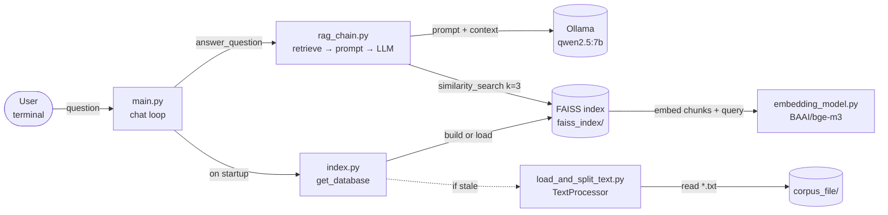
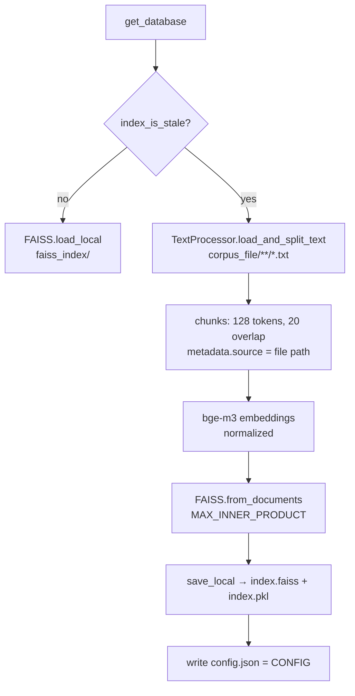
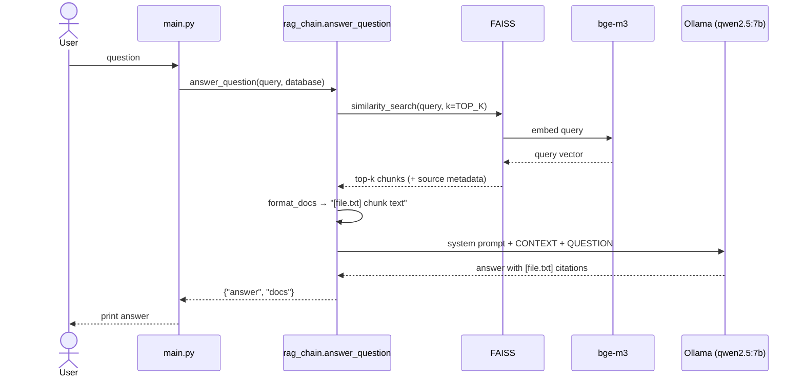

# Embedding Search: RAG Chatbot

A small Retrieval-Augmented Generation (RAG) chatbot that runs fully on your machine. It answers questions about local `.txt` files by:

1. finding the most relevant passages with semantic (embedding) search, and
2. asking a local LLM to answer **only** from those passages, citing the source file.

- **Embeddings:** [BAAI/bge-m3](https://huggingface.co/BAAI/bge-m3) via HuggingFace (multilingual, so English and Vietnamese both work, including cross-lingual queries)
- **Vector store:** [FAISS](https://github.com/facebookresearch/faiss), inner-product similarity on normalized vectors
- **LLM:** `qwen2.5:7b` served by [Ollama](https://ollama.com), temperature 0
- **Glue:** [LangChain](https://python.langchain.com)

## Table of contents

- [Architecture](#architecture)
  - [Architecture diagram file](#architecture-diagram-file)
  - [Components](#components)
  - [Indexing flow](#indexing-flow)
  - [Question flow](#question-flow)
  - [When the index is rebuilt](#when-the-index-is-rebuilt)
  - [Prompt rules](#prompt-rules)
- [Project structure](#project-structure)
- [Getting started](#getting-started)
- [Configuration](#configuration)
- [Using your own documents](#using-your-own-documents)
- [Evaluation](#evaluation)
- [Notes and limitations](#notes-and-limitations)

## Architecture



The system has two paths:

- **Indexing path** (startup, only when needed): corpus → chunks → embeddings → FAISS index on disk.
- **Question path** (every query): question → top-k chunks from FAISS → prompt → Ollama → answer with citations.

### Architecture diagram file

[`rag-chatbot-architecture.html`](rag-chatbot-architecture.html) is an interactive version of the diagram above. Open it in any browser (it is a single standalone file, no server needed). It supports:

- dark and light themes,
- clicking a component to see what it does and which source lines it comes from (e.g. `embedding/index.py:11-32` for the staleness check),
- animated flow along the connections,
- export to PNG / SVG / WebM.

It was generated with the archify skill in Claude Code. The files in [`.archify/`](.archify/) are its build artifacts:

| File | Purpose |
|---|---|
| `candidate.json` | The diagram spec: components, connections, side cards, and the source-file/line references for each component. Edit this to change the diagram. |
| `rag-chatbot.html` | The rendered diagram (same content as `rag-chatbot-architecture.html`). |
| `rag-chatbot.delivery.json`, `rag-chatbot.finalize*.json`, `rag-chatbot.browser-check.json` | Validation receipts (validate / deliver / check passed; the headless browser check was skipped because no Chrome was found). |

The diagram reflects commit `3a3afac`. If you change the architecture (new component, different chunk size, another LLM), regenerate it so it stays accurate.

### Components

| Component | File | Responsibility |
|---|---|---|
| Configuration | `embedding/config.py` | Single source of truth for chunking, embedding model, LLM name, `TOP_K`, and all paths. `CONFIG` is also stamped into the index folder to detect changes. |
| Text loader & splitter | `embedding/load_and_split_text.py` | `TextProcessor` loads every `.txt` in `corpus_file/` (UTF-8) with `DirectoryLoader` and splits it with `RecursiveCharacterTextSplitter`, measuring length in **bge-m3 tokens** (128 tokens, 20 overlap). |
| Embedding model | `embedding/embedding_model.py` | `get_embeddings()` returns a `HuggingFaceEmbeddings` for bge-m3 with normalized vectors, so inner product equals cosine similarity. |
| Vector index | `embedding/index.py` | `get_database()` is the single entry point: it checks `index_is_stale()`, then either rebuilds (`build_index`) or loads (`load_index`) the FAISS index. Used by both `main.py` and `evaluation.py`. |
| RAG chain | `embedding/rag_chain.py` | `answer_question()` retrieves the top-k chunks, formats them as `[source] text`, fills the prompt template, calls `ChatOllama`, and returns `{"answer", "docs"}`. |
| Chat CLI | `embedding/main.py` | Loads the database once, then loops: read a question, call `answer_question`, print the answer. Type `stop` to exit. |
| Evaluation | `embedding/evaluation.py` | Measures retrieval quality (Hit@k and MRR) against `corpus_file/test_set/testset.json`. Not part of the chat path. |
| Legacy | `embedding/build_or_load_data.py` | Old version of the build/load logic. Not imported anywhere and does not run; superseded by `index.py`. |

### Indexing flow



The saved index lives in `embedding/faiss_index/`:

| File | Contents |
|---|---|
| `index.faiss` | The FAISS vectors |
| `index.pkl` | The docstore (chunk text + metadata such as `source`), pickled by LangChain |
| `config.json` | The `CONFIG` used to build this index; compared on each start |

### Question flow



### When the index is rebuilt

`index_is_stale()` returns `True` (rebuild) if any of these hold; otherwise the saved index is loaded from disk, which is much faster:

1. `faiss_index/index.faiss` is missing,
2. `faiss_index/config.json` is missing,
3. the saved `config.json` differs from the current `CONFIG` (e.g. you changed `chunk_size` or the model),
4. any `.txt` file, or any folder, under `corpus_file/` is newer than `index.faiss` (covers added, edited and deleted files).

Note that `TOP_K` and `LLM_MODEL` are not part of `CONFIG`, so changing them does **not** trigger a rebuild (they don't need to).

### Prompt rules

The system prompt in `rag_chain.py` tells the LLM to:

1. use **only** the information in the CONTEXT section, not its own knowledge;
2. reply exactly `No information found in the documents.` if the context does not contain the answer;
3. cite the source file in square brackets after each point, e.g. `[datafile.txt]`.

Combined with `temperature=0`, this keeps answers grounded and repeatable.

## Project structure

```
embedding_search/
├── README.md
├── rag-chatbot-architecture.html   # interactive architecture diagram (open in a browser)
├── .archify/                       # diagram spec + build receipts for the file above
├── corpus_file/
│   ├── datafile.txt                # sample corpus: history of Mississippi (English)
│   ├── vietnam_data.txt            # sample corpus: Vietnam (Vietnamese)
│   └── test_set/
│       └── testset.json            # 25 labeled queries for evaluation
└── embedding/
    ├── config.py                   # settings: chunking, models, TOP_K, paths
    ├── load_and_split_text.py      # TextProcessor: load + token-based chunking
    ├── embedding_model.py          # bge-m3 HuggingFace embeddings
    ├── index.py                    # FAISS build / load / staleness check
    ├── rag_chain.py                # prompt, Ollama LLM, answer_question()
    ├── main.py                     # interactive chat CLI (entry point)
    ├── evaluation.py               # retrieval metrics: Hit@k, MRR
    ├── build_or_load_data.py       # legacy, unused
    └── faiss_index/                # saved index (auto-generated)
        ├── index.faiss
        ├── index.pkl
        └── config.json
```

## Getting started

### 1. Prerequisites

- Python 3.10+
- [Ollama](https://ollama.com/download) installed and running

### 2. Pull the LLM

```bash
ollama pull qwen2.5:7b
```

Keep Ollama running (the desktop app, or `ollama serve`).

### 3. Install Python dependencies

```bash
python -m venv .venv
source .venv/bin/activate

pip install langchain-core langchain-community langchain-huggingface \
            langchain-text-splitters langchain-ollama \
            transformers sentence-transformers faiss-cpu
```

### 4. Run the chatbot

The scripts import each other by module name, so run them from inside `embedding/`:

```bash
cd embedding
python main.py
```

Example session:

```
Enter your query (type stop to exit): When did Mississippi become a state?
Mississippi became the 20th state on December 10, 1817 [datafile.txt].

Enter your query (type stop to exit): What is the weather in Paris in December?
No information found in the documents.

Enter your query (type stop to exit): stop
```

The first run downloads the bge-m3 model (~2 GB) and builds the index, so it takes a while. Later runs load the saved index.

## Configuration

All settings are in `embedding/config.py`:

| Setting | Default | Description | Rebuilds index? |
|---|---|---|---|
| `CONFIG["chunk_size"]` | `128` | Chunk length, in bge-m3 tokens | Yes |
| `CONFIG["chunk_overlap"]` | `20` | Overlap between consecutive chunks, in tokens | Yes |
| `CONFIG["model_name"]` | `BAAI/bge-m3` | HuggingFace embedding model (also used as the tokenizer for chunking) | Yes |
| `CONFIG["normalize_embeddings"]` | `True` | Normalize vectors so inner product = cosine similarity | Yes |
| `CONFIG["glob"]` | `**/*.txt` | Which files in `corpus_file/` to load | Yes |
| `LLM_MODEL` | `qwen2.5:7b` | Ollama model name; any model you've pulled works | No |
| `TOP_K` | `3` | Number of chunks retrieved per question | No |
| `CORPUS_DIR` | `../corpus_file` | Folder with source documents | — |
| `FAISS_INDEX_PATH` | `./faiss_index` | Where the index is saved | — |
| `TESTSET_PATH` | `../corpus_file/test_set/testset.json` | Evaluation set | — |

## Using your own documents

1. Put UTF-8 `.txt` files into `corpus_file/` (subfolders are fine).
2. Run `python main.py` again. The index rebuilds automatically because the corpus is newer than the index.

The file name becomes the citation, so give files meaningful names.

## Evaluation

`evaluation.py` measures **retrieval** quality (does FAISS return the right chunk?), not the LLM's answer.

```bash
cd embedding
python evaluation.py
```

**Test set** (`corpus_file/test_set/testset.json`): 25 queries, each shaped like

```json
{
  "id": "ms-01",
  "query": "When did Mississippi become a state?",
  "lang": "en",
  "type": "keyword",
  "answerable": true,
  "sources": ["datafile.txt"],
  "evidence": ["became the 20th state on December 10, 1817"],
  "answer": "December 10, 1817 (the 20th state)."
}
```

- 15 answerable, 10 unanswerable
- types: `paraphrase` (8), `near_topic` (7), `cross_lingual` (4), `off_topic` (3), `keyword` (2), `multi_source` (1)
- languages: English and Vietnamese

**Metrics**, computed over the answerable queries only:

- **Hit@k**: share of queries where at least one of the top-k chunks contains an `evidence` string.
- **MRR** (Mean Reciprocal Rank): average of `1 / rank` of the first chunk containing evidence (0 if none).

Evidence matching uses Unicode NFC normalization so Vietnamese diacritics compare correctly. The script also prints every missed query with its id and type. Unanswerable queries are loaded but not scored yet.

## Notes and limitations

- **Pickle loading:** `load_index` uses `allow_dangerous_deserialization=True` because LangChain stores the docstore as a pickle. Only load `faiss_index/` folders you built yourself.
- **Local only:** both the embedding model and the LLM run locally; no API keys are needed, but a 7B model needs several GB of RAM.
- **Run location:** scripts must be run from `embedding/` because they use plain `from config import ...` imports.
- **No chat memory:** each question is answered independently; previous turns are not sent to the LLM.
- **`.txt` only:** other formats (PDF, DOCX) need a different loader in `load_and_split_text.py`.
